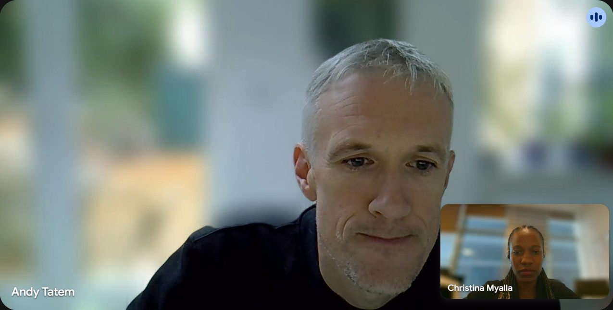

::: {.gallery-item}
{fig-alt="Christina Myalla speaking on a panel, shown on the large screen at IHI's 70th anniversary conference"}

**Panel: "The Voice of Scientists for the Next 70 Years"**\
IHI 70th Anniversary & 5th Ifakara Annual Scientific Conference, APC Conference Centre, Dar es Salaam, 12 November 2026
:::

::: {.gallery-item}
{fig-alt="Christina Myalla with Prof. Fredros Okumu and IHI colleagues at the 70th anniversary conference"}

**With Prof. Fredros Okumu and IHI colleagues**\
A privilege to spend time with Prof. Fredros Okumu, Professor of Vector Biology at the University of Glasgow and former Director of Science at IHI, whose passion for science continues to inspire me. IHI 70th Anniversary & 5th Ifakara Annual Scientific Conference, APC Conference Centre, Dar es Salaam, 10 November 2026
:::

::: {.gallery-item}
{fig-alt="Video call between Christina Myalla and Prof. Andy Tatem"}

**Conversation with Prof. Andy Tatem**\
Honoured to speak with Prof. Andy Tatem (WorldPop, University of Southampton), a leader in spatial demography and population mapping for global health. Online, 5 November 2026
:::
