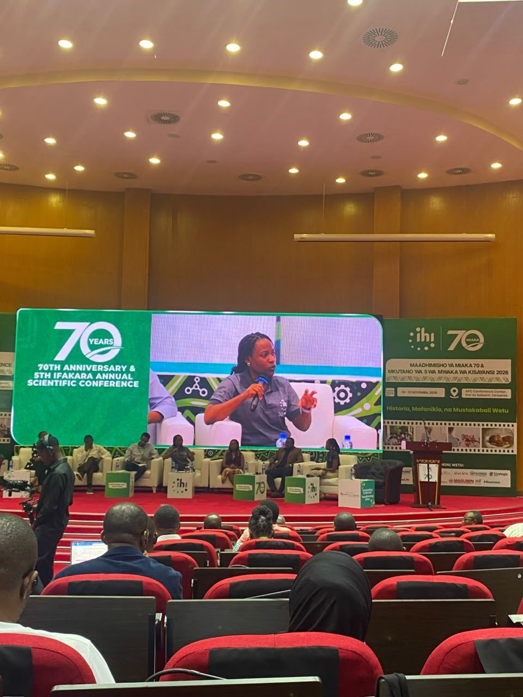
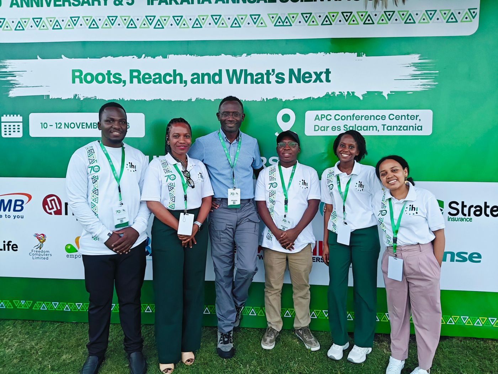

::: {.gallery-item}
{fig-alt="Christina Myalla speaking on a panel, shown on the large screen at IHI's 70th anniversary conference"}

**Panel: "The Voice of Scientists for the Next 70 Years"**\
IHI 70th Anniversary & 5th Ifakara Annual Scientific Conference, APC Conference Centre, Dar es Salaam, 12 November 2026
:::

::: {.gallery-item}
{fig-alt="Christina Myalla with Prof. Fredros Okumu and IHI colleagues at the 70th anniversary conference"}

**With Prof. Fredros Okumu and IHI colleagues**\
A privilege to spend time with Prof. Okumu, IHI's Director of Science, whose passion for science and impact on malaria research continue to inspire me. IHI 70th Anniversary & 5th Ifakara Annual Scientific Conference, APC Conference Centre, Dar es Salaam, 10 November 2026
:::
